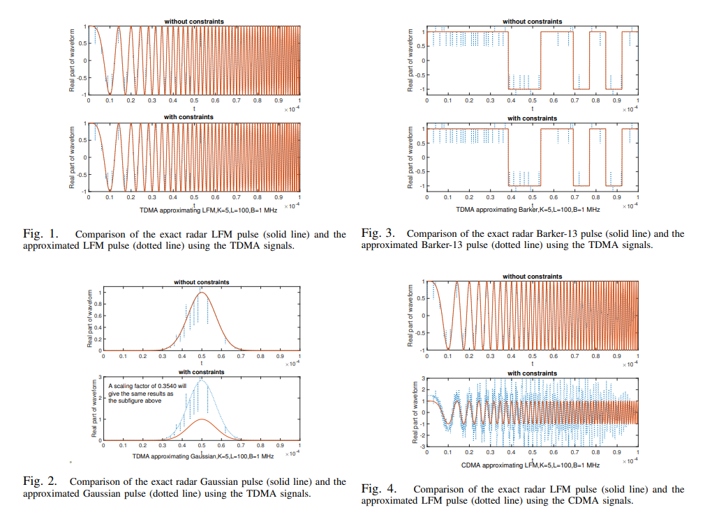
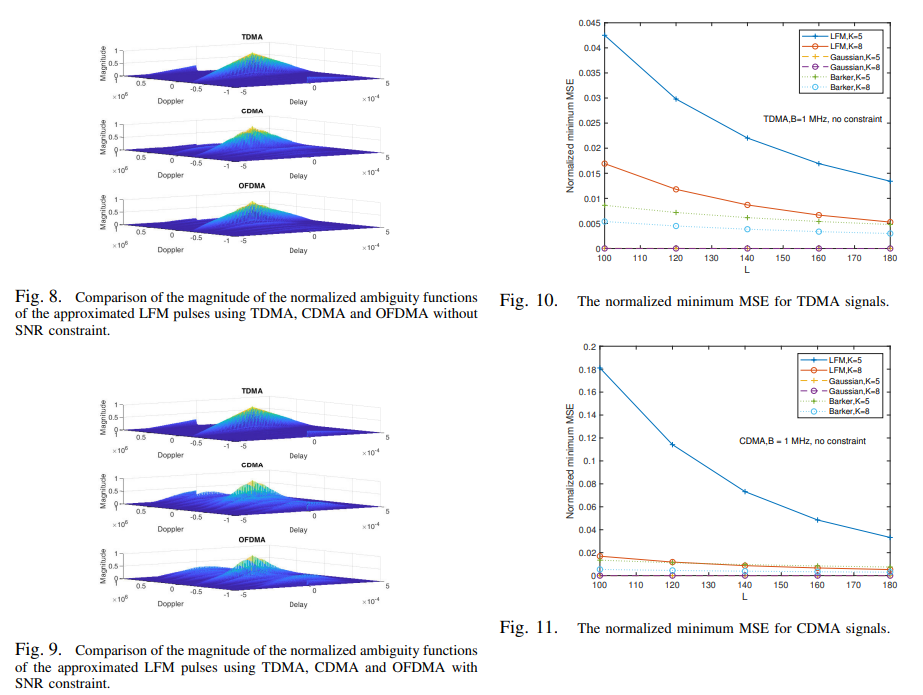

# [JRC] Radar - Communication Joint Waveform Design Based on Multi-User Reuse Signal - [Attached MATLAB + Python Code]

In applications where radar and communication systems share the same frequency band or operate simultaneously with radar perception and information communication functions, radar-communication joint design has been widely studied. Due to the differences in operation between radar and communication, finding suitable waveforms for both is challenging. This paper proposes a new method for designing dual-function waveforms for radar and communication using multi-user multiplexed communication signals. Specifically, signals that recombine across different data bits at different time domains, code domains, or frequencies are linearly combined to generate the overall radar waveform. Three typical radar waveforms are considered, and the coefficients of the linear combination are optimized to minimize mean square error under conditions of varying communication signal signal-to-noise ratio (SNR). Numerical results show that the optimization without SNR constraints can almost perfectly approximate the radar waveform in all cases, thus providing a good dual-function waveform for radar and communication. Additionally, in different multiplexing techniques, Time Division Multiple Access (TDMA) is the best choice for approximating the radar waveform, followed by Code Division Multiple Access (CDMA) and Orthogonal Frequency Division Multiple Access (OFDMA).
Introduction
Historically, due to their distinct functions, radar and communication systems have developed separately. In recent years, these two systems have begun to integrate, primarily for two reasons. First, the issue of "spectrum scarcity" in communications has become increasingly severe, making it necessary for communication systems to utilize as many available radio frequency bands as possible, including those currently open for shared access, including radar bands. Consequently, interference between radar and communication becomes inevitable, making joint design of radar and communication essential. Second, future emerging applications require a system capable of both information communication and radar perception, such as autonomous driving and asset tracking. This requires integrated design of radar and communication capabilities.
Despite the use of similar statistical signal processing techniques in radar and communication systems, there are still significant differences between them. These distinct characteristics present challenges for joint radar-communication design. One challenge is waveform design, as the requirements for "good" waveforms differ between radar and communication functions, yet a single waveform must be used to achieve both functionalities within a unified radar-communication system. Consequently, extensive research has been conducted to find dual-function waveforms. These dual-function waveforms (including those proposed in this paper) can be utilized in various applications, including vehicle-to-infrastructure communication for obstacle detection while transmitting data, low-probability interception communication by hiding communication data within radar pulses, and RFID for simultaneous positioning and communication information. For additional application scenarios, refer to relevant literature.
A widely used method involves embedding communication symbols into radar waveforms. For example, in some studies, antenna arrays are divided into multiple subarrays, with each subarray transmitting orthogonal radar waveforms. The communication symbols are embedded into the amplitude or phase difference of the waveform pairs. Similarly, by controlling different spread spectrum sequences as orthogonal radar waveforms, communication symbols are embedded into the radar waveforms, whereby the receiver decodes the transmitted information by determining which sequence was transmitted. In other studies, by modulating the phase or amplitude of the linear frequency modulation (LFM) waveform of the radar, communication symbols are embedded into the radar waveforms, making the radar waveform serve as the carrier for communication. Additionally, through remodulating the incident radar signal, communication symbols are embedded into the radar waveforms.
Another widely used method is waveform diversity. For example, in some studies, radar signals are transmitted through the main lobe of an antenna array, while communication symbols are transmitted through the side lobes of the same array. In other studies, radar and communication are combined by modulating the same carrier with linear frequency modulation for radar and continuous phase modulation for communication, respectively. Another study combines both by modulating the phase of the same carrier, where one phase component represents radar and the other communication. Additionally, orthogonal frequency division multiplexing (OFDM) signals are used for communication, but their parameters are adjusted to suit radar applications. OFDM waveform design for radar research alone is also a fascinating topic. Other works consider optimizing radar waveforms to minimize their impact on coexisting communication systems. More interesting discussions on dual-function waveform design can be found in related literature.
The above work provides very useful guidance for dual-function waveform design. However, most of these works only use a single communication user's signal in the design. On the other hand, in many communication systems, base stations typically serve multiple users in downlink. For such systems using multiple antennas, related research explores different beamforming schemes to exploit the spatial orthogonality of users to design dual-function waveforms. If these systems use a single antenna or do not perform beamforming, spatial orthogonality cannot be utilized, but users can still use time-division multiple access (TDMA), code-division multiple access (CDMA), or orthogonal frequency division multiple access (OFDMA) for multiplexing, so the temporal, code, or frequency orthogonality of multiple multiplexed users can be used for dual-function waveform design. One such approach is to combine signals from multiple communication users with different bit intervals to approximate radar waveforms, allowing radar receivers to use the overall approximation for target detection, while communication receivers can separate their signals from the overall waveform using orthogonal functions in time, code, and frequency domains for information decoding.
The purpose of this work is to study the problem of approximating radar pulses using signals from multiple communication users with different bit intervals for dual-function waveform design for radar and communication. Specifically, linear combinations of signals from different TDMA, CDMA, or OFDMA users are performed. The coefficients of the linear combinations are derived by minimizing the mean square error. Attention is also given to unconstrained minimization to emphasize the accuracy of radar function approximation, as well as constrained minimization to avoid degrading communication service quality due to linear combination. Numerical results show that TDMA has the highest precision, followed by CDMA and OFDMA. In addition, TDMA and CDMA can reasonably approximate all three commonly used radar pulses.
Figure caption:
Conclusion:
This paper investigates the design issue of dual-function waveforms in a radar - communication joint system. A new method is proposed to combine signals from multiple communication users with different bit intervals to generate radar waveforms. The accuracy of generated radar pulses under constraints of signal-to-noise ratio (SNR) and without SNR constraint optimization is studied. Numerical results indicate that optimization without SNR constraint can generate very accurate radar pulses in almost all considered cases, while optimization with SNR constraint requires scaling before combination. It is also shown that TDMA signals are the best choice for generating radar pulses, and Gaussian pulses are the easiest to generate. Further reduction in approximation error can be achieved by increasing the number of communication users or data bits in the combination. Future work includes exploring additional degrees of freedom in the spatial domain to extend the research to multi-antenna systems.
End

## Images

<!-- PAYMENT_BLOCK -->

## Get this dataset

- Payment link (Stripe): [Buy now](https://buy.stripe.com/3cs8yP7sY87d0vu9AB)
- Payment QR code: 

<!-- /PAYMENT_BLOCK -->
